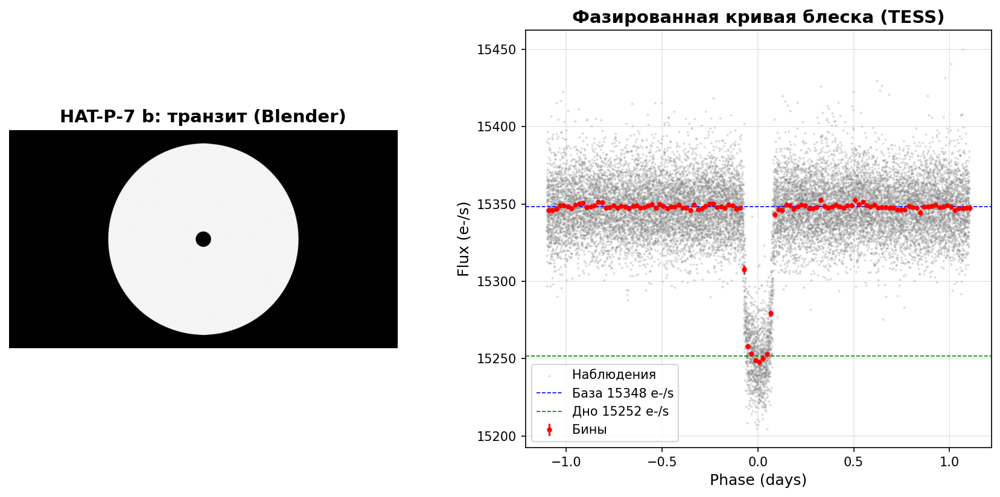

# HAT-P-7 b: Transit Rediscovery from TESS Photometry

A student end-to-end project: from raw space telescope photometry to
measured planetary parameters and a physically scaled 3D visualization.

## Overview

- Downloaded the TESS light curve of HAT-P-7 (TIC 424865156), Sector 14
  (SPOC pipeline, 120 s cadence) via `lightkurve`
- Cleaned outliers, normalized, and phase-folded the light curve
- Detected the orbital period with the Box Least Squares algorithm
- Derived planet radius, semi-major axis and equilibrium temperature
  from the measured transit depth and period
- Built a true-scale 3D scene of the system and rendered a transit
  animation in Blender 5.2 LTS

## Key results

| Parameter | This work | Literature |
|---|---|---|
| Orbital period, days | 2.2057 | 2.2047 (Bakos et al. 2009) |
| Transit depth, % | 0.628 | ~0.65 |
| Planet radius, R_Jup | 1.42 | 1.43-1.55 |
| Semi-major axis, AU | 0.0377 | 0.0379 |
| Equilibrium temperature (A=0), K | 2139 | ~2150-2200 |

## Figure 1: geometry meets data

Left: true-scale transit geometry (Blender). Right: phase-folded TESS
light curve with 30-minute bins; dashed lines mark the baseline and
the transit bottom.

## Transit animation

One full orbit (12 s at 24 fps); the planet crosses the stellar disk
for ~1 s, reproducing the dip seen in the photometry.

## Repository structure

- `notebooks/` — analysis notebook (data → BLS → folding → parameters)
- `blender/` — scene and animation scripts (Blender 5.2 LTS)
- `data/` — binned phase-folded light curve, derived parameters (JSON)
- `figures/` — figures and rendered video

## Reproducing

1. `pip install -r requirements.txt`
2. Run `notebooks/01_first_lightcurve.ipynb` from top to bottom
   (downloads ~10 MB of TESS data from MAST)
3. Optional: open `blender/hatp7_system.blend` or run the scripts in
   Blender 5.2 LTS to regenerate the visualization

## References

- Bakos et al. 2009, HAT-P-7 b discovery
- Ricker et al. 2015, TESS mission
- Kovacs, Zucker & Mazeh 2002, Box Least Squares
- Lightkurve Collaboration 2018

## Author

Gromov Nikita — 3rd year student, Peter the Great St. Petersburg
Polytechnic University (space research track, based at Ioffe Institute).
Project status: in progress.
